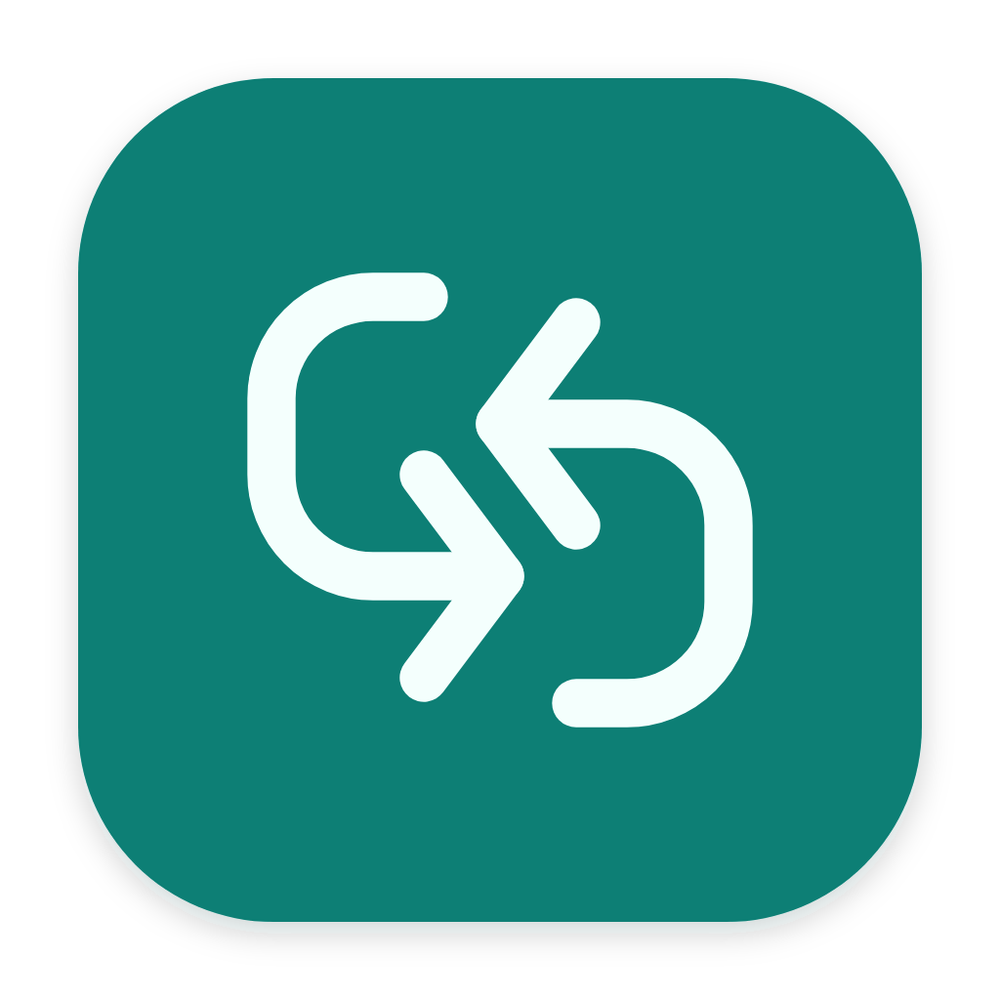
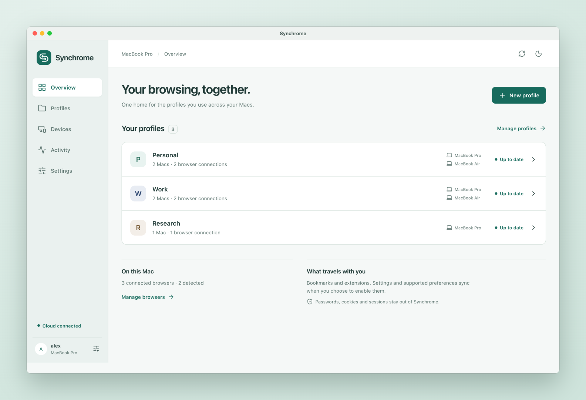
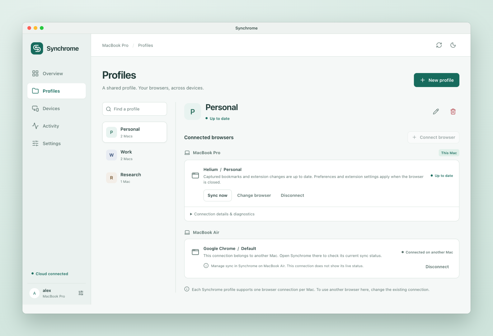
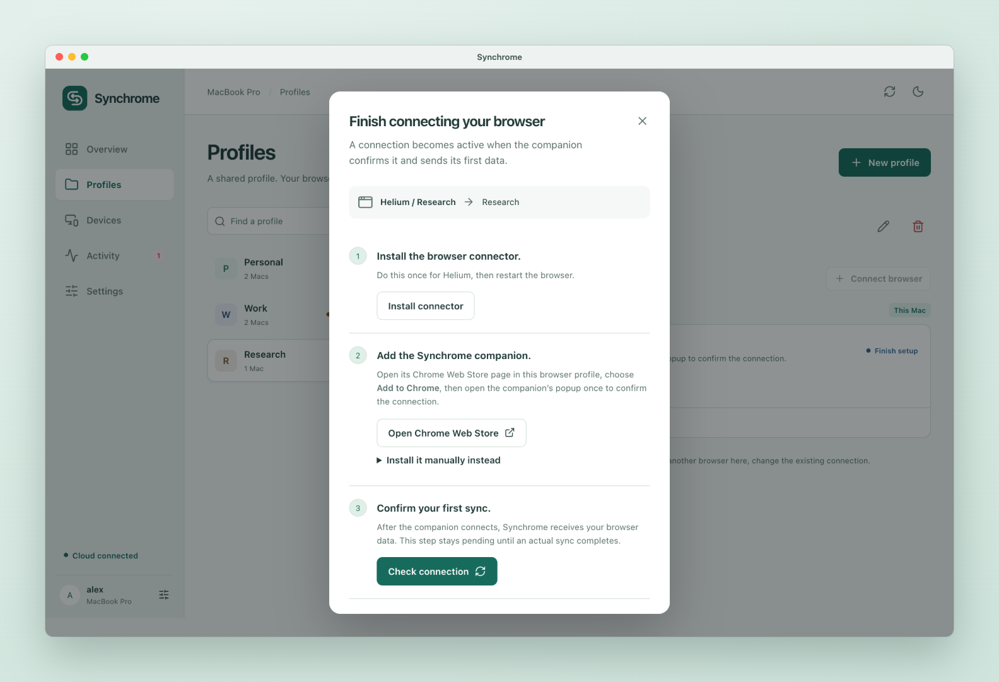
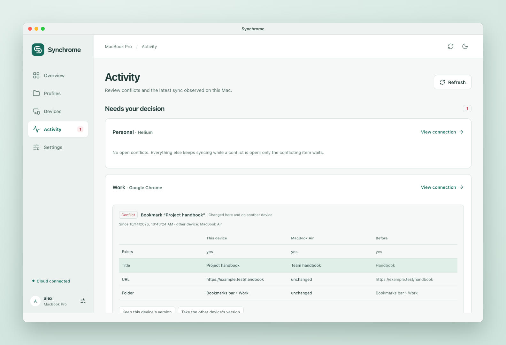
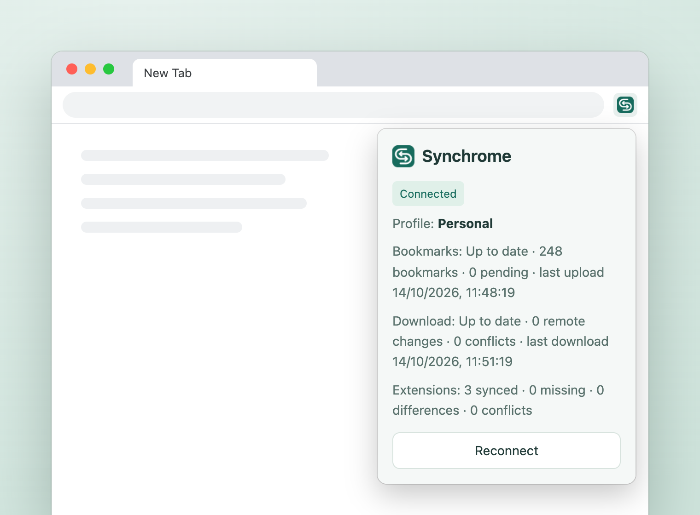
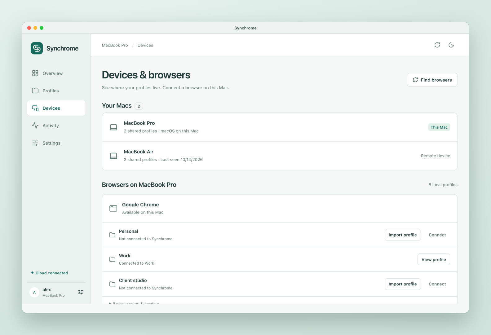
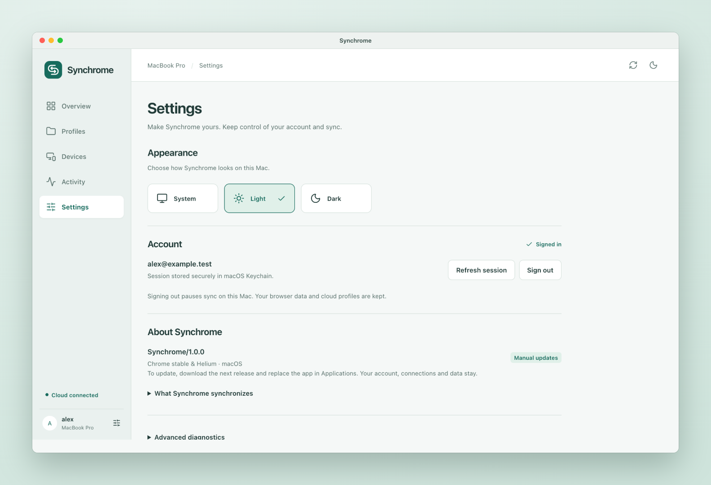
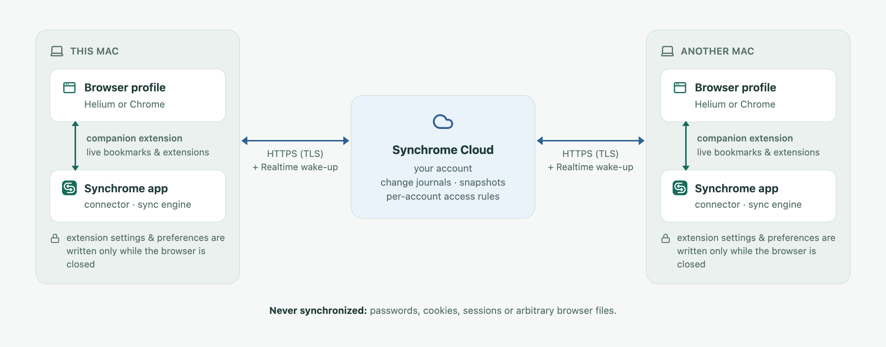

<div align="center">



# Synchrome

**One profile, every Mac — without Google Sync.**

Synchrome keeps your Chromium browser profiles in sync across your Macs: bookmarks, extensions,
extension settings and selected browser preferences, for Helium and Google Chrome.

[](https://github.com/xavirn89/synchrome/releases/latest)
[](https://chromewebstore.google.com/detail/synchrome/ceflmoojogokmklgcmcihdgakbefgiee)


[](LICENSE)

[**Download for macOS**](https://github.com/xavirn89/synchrome/releases/latest) ·
[Companion extension](https://chromewebstore.google.com/detail/synchrome/ceflmoojogokmklgcmcihdgakbefgiee) ·
[How it works](#how-it-works) ·
[Documentation](#documentation)

<br>

<picture>
  <source media="(prefers-color-scheme: dark)" srcset="docs/readme/overview-dark.png">
  
</picture>

</div>

## Why Synchrome

Chromium browsers keep a profile's bookmarks, extensions and settings on one machine unless you
hand them to a browser vendor's account. Synchrome gives you **your own sync**: a profile you
create once and connect from the browsers on each of your Macs. It works with browsers that have
no sync of their own, such as [Helium](https://helium.computer), and with Chrome without a Google
account.

| | |
|---|---|
| **Bookmarks, live** | The full bookmark tree and its order, applied in the running browser within moments. Edits that collide across Macs are recorded as conflicts for you to review. |
| **Extensions follow you** | Installed extensions and their enabled state. A missing extension opens its store page for you to add; uninstalling always asks first. |
| **Opt-in settings** | Extension settings and four allow-listed browser preferences, per connection, written only while the browser is closed so Chromium never overwrites them. |
| **Profiles, not files** | Synchrome profiles are the thing you manage: connect each one to a browser profile per Mac, see every Mac at a glance, disconnect without losing local data. |
| **Honest status** | Every connection shows whether it is up to date, waiting for the browser to close, in conflict or needing you — with recovery steps instead of raw errors. |
| **Private by design** | Passwords, cookies and sessions are never synchronized. Account secrets live in the macOS Keychain; the app ships no admin credentials. |

## Screenshots

<table>
  <tr>
    <td width="50%">
      <picture>
        <source media="(prefers-color-scheme: dark)" srcset="docs/readme/profile-dark.png">
        
      </picture>
      <p align="center"><b>Profiles.</b> One Synchrome profile, its browser connections on each Mac.</p>
    </td>
    <td width="50%">
      <picture>
        <source media="(prefers-color-scheme: dark)" srcset="docs/readme/setup-dark.png">
        
      </picture>
      <p align="center"><b>Guided setup.</b> Connector, companion and first sync, step by step.</p>
    </td>
  </tr>
  <tr>
    <td width="50%">
      <picture>
        <source media="(prefers-color-scheme: dark)" srcset="docs/readme/activity-dark.png">
        
      </picture>
      <p align="center"><b>Conflict review.</b> Choose which edit wins when two Macs disagree.</p>
    </td>
    <td width="50%">
      <picture>
        <source media="(prefers-color-scheme: dark)" srcset="docs/readme/companion-dark.png">
        
      </picture>
      <p align="center"><b>Companion.</b> Connection and sync state, right in the browser.</p>
    </td>
  </tr>
  <tr>
    <td width="50%">
      <picture>
        <source media="(prefers-color-scheme: dark)" srcset="docs/readme/devices-dark.png">
        
      </picture>
      <p align="center"><b>Devices &amp; browsers.</b> Every Mac and every detected browser profile.</p>
    </td>
    <td width="50%">
      <picture>
        <source media="(prefers-color-scheme: dark)" srcset="docs/readme/settings-dark.png">
        
      </picture>
      <p align="center"><b>Settings.</b> System, light and dark appearance; account and app details.</p>
    </td>
  </tr>
</table>

<sub>Screenshots use the app's built-in sample data; light or dark follows your GitHub theme.</sub>

## How it works

<picture>
  <source media="(prefers-color-scheme: dark)" srcset="docs/readme/how-it-works-dark.png">
  
</picture>

- **The Synchrome app** owns your account, the sync engine and all file-level work. It discovers
  your browsers and profiles, keeps a local state database and exchanges changes with Synchrome
  Cloud as per-device journals and periodic snapshots.
- **The companion extension** is a thin bridge, connected to the app through Chrome's native
  messaging. It reports bookmark and extension changes as they happen and applies remote ones in
  the running browser. It holds no sync logic and never sees your account credentials.
- **Synchrome Cloud** stores each account's data behind per-account access rules and wakes the
  other Macs through Realtime notifications, with polling as a fallback.
- **Closed-browser writes.** Chromium rewrites its preference and extension-storage files while it
  runs, so those changes wait in a queue and are applied, after a backup, the next time the
  browser is closed.

## Get started

1. **Download** the latest `Synchrome_<version>_aarch64.dmg` from
   [Releases](https://github.com/xavirn89/synchrome/releases/latest). It is signed with a
   Developer ID and notarized by Apple.
2. **Install**: open the DMG and drag Synchrome to **Applications**. Open it from there — the
   browser connector is only installed from that stable location.
3. **Sign in** or create a Synchrome account.
4. **Google Chrome only**: grant Synchrome **Full Disk Access** in *System Settings → Privacy &
   Security → Full Disk Access*, then reopen Synchrome. macOS protects Chrome's profile folder;
   Helium needs no permission.
5. **Create a profile** from a browser profile (it becomes the initial source) or start fresh,
   then choose **Finish setup**:
   1. **Install connector**, then restart the browser.
   2. **Open Chrome Web Store** — the companion's page opens in the right browser profile; choose
      *Add to Chrome*.
   3. **Check connection** and wait for the first sync to complete.
6. Repeat on your other Mac and choose **Connect browser** on the same profile.

Bookmarks and extension state then sync live. Turn on extension settings and preferences per
connection when you want them.

<details>
<summary><b>Manual companion install, moving to the store companion, updates</b></summary>

- **Manual install.** In *Finish setup*, *Install it manually instead* reveals the companion
  bundled inside the app. Load it from `chrome://extensions` → *Developer mode* → *Load unpacked*.
- **Moving an existing connection to the store companion.** Add the store companion, remove the
  manually loaded one, then quit the browser for a few seconds: Synchrome (1.0.7+) hands the
  connection over while the browser is closed.
- **Updates are manual in 1.0.** Download the new DMG and replace the app in Applications. Your
  account, connections and data stay.

</details>

## Supported browsers

| Browser | Status | Notes |
|---|---|---|
| [Helium](https://helium.computer) | Validated end to end | No macOS permission needed |
| Google Chrome (stable) | Validated end to end | Requires Full Disk Access |
| Brave, Microsoft Edge, Chromium | Detected, not validated | Shared Chromium code paths; use at your own risk |

**Requirements:** macOS 12 or later on Apple silicon, and a Synchrome account. Each Synchrome
profile supports one browser connection per Mac.

## What syncs

| Data | When | Default |
|---|---|---|
| Bookmarks (full tree and order) | Live, through the companion | Always on |
| Installed extensions + enabled state | Live, through the companion | Always on; installs and uninstalls ask you |
| Extension settings (`storage.local`, `storage.sync`) | While the browser is closed | Opt-in per extension; deny-listed keys, 5 MB cap |
| Browser preferences (4 allow-listed) | While the browser is closed | Opt-in per connection |
| Passwords, cookies, sessions, arbitrary files | **Never** | Use your password manager |

Not in 1.0: browsing history, tracked preferences, IndexedDB / Local Storage, Windows and Linux,
end-to-end encryption. See the [roadmap](#roadmap).

## Privacy and security

- **Never synchronized:** passwords, cookies, sessions or arbitrary browser files.
- **Credentials stay native.** Your account session lives in the macOS Keychain and never reaches
  the interface's storage or the browser; the companion holds only a per-connection link token.
- **No admin secrets in the app.** The app ships only the public cloud URL and anonymous key;
  per-account access rules protect every table and storage path.
- **Safe by default.** Closed-browser writes happen after a backup; disconnecting or deleting a profile
  keeps your local browser profiles, bookmarks and files.
- **Least privilege.** The companion asks for `bookmarks`, `management`, `nativeMessaging`,
  `storage` and `alarms` only and runs no remote code.

Privacy policy: <https://www.garduc.com/synchrome/privacy/> · Support: xavirn.me@gmail.com

## Roadmap

Synchrome 1.0 is the complete first version for macOS. Planned after 1.0:

- [ ] Public (searchable) Chrome Web Store listing
- [ ] Automatic updates with signed update manifests
- [ ] End-to-end validation for Brave, Edge and Chromium
- [ ] Browsing history sync
- [ ] Extension IndexedDB and Local Storage
- [ ] Windows and Linux builds
- [ ] Additional stores (GitHub repository, local or network folder) and end-to-end encryption

The exact 1.0 scope, exclusions and known limitations are in
[docs/06 §0](docs/06-v1-plan.md#0-synchrome-v1--done-2026-10-03-version-100).

## Development

Synchrome is a [Tauri 2](https://tauri.app) app: a Rust backend and sync engine with a
[Svelte 5](https://svelte.dev) interface. The companion is a Manifest V3 extension.

```bash
cargo fmt --all -- --check
cargo clippy --workspace --all-targets -- -D warnings
cargo test --workspace
```

From `apps/desktop`:

```bash
pnpm install && node --test tests/*.test.js && pnpm build
```

The app with the embedded frontend:

```bash
cargo build -p synchrome-desktop --features tauri/custom-protocol
```

- **UI preview.** `pnpm exec vite` serves the interface; add `?preview=workspace` (or `showcase`,
  `auth`, `offline`…) for a token-free, in-memory development adapter. It is only available in
  the development server, never in production builds.
- **Release.** `scripts/release-macos.sh` builds, signs with Developer ID, packages the DMG and,
  with App Store Connect API key variables set, notarizes and staples the app and the DMG.
- **End-to-end tests.** Debug builds carry a development CLI and test hooks (absent from release
  builds) used by the harnesses in `tests/experiments/`, which only touch disposable browser
  profiles.
- **README images** are generated from the real interface by `scripts/readme-images/`.

<details>
<summary><b>Repository layout</b></summary>

```text
crates/
  synchrome-types     shared domain types (BrowserKind, AccessState, DiscoveredBrowser/Profile, user_agent)
  synchrome-browser   browser & profile discovery, macOS TCC access detection, Preferences / LevelDB writers, native host manifest
  synchrome-config    client configuration (public values; baked in at release build time)
  synchrome-auth      Supabase Auth (Keychain session)
  synchrome-cloud     Synchrome Cloud client (profiles, mappings, devices, Storage, store_events, snapshots, cursors, Realtime frames)
  synchrome-device    device identity + app data dir
  synchrome-sync      sync engine: HLC, ops, per-collection merge rules, snapshots, wake-up coalescing
  synchrome-state     local state (SQLite): capture, publish, pull, conflicts, compaction, bootstrap
  synchrome-bridge    extension <-> app native-messaging protocol + local token registry
apps/desktop/         Tauri 2 app (Rust commands, background sync loop, Realtime supervisor) + Svelte UI
apps/extension/       companion extension (bookmarks + extension events, applies remote changes)
cloud/migrations/     Supabase SQL (0001–0005, applied on the server; never run by the client)
distribution/         Chrome Web Store listing, privacy disclosures and assets
scripts/              release, packaging and README image scripts
tests/experiments/    Milestone 0 experiments and the end-to-end harnesses
docs/                 specification (00–06), release checklist (07), brand and UI notes
```

</details>

## Documentation

| Document | Content |
|---|---|
| [Product](PRODUCT.md) · [Design](DESIGN.md) | The product and design contract the app implements |
| [00 — Original brief](docs/00-original-brief.md) | The project brief and planning-phase requirements |
| [01 — Chromium internals](docs/01-chromium-internals.md) | Where each kind of profile data lives, how Chromium locks and writes it, what was verified by experiment |
| [02 — Feasibility](docs/02-feasibility.md) | What is realistically syncable, through which access path, and the closest safe alternative |
| [03 — Data model and sync](docs/03-data-model-and-sync.md) | Identities, clocks, entities, the sync cycle, merge rules, conflicts, deletions, backups |
| [04 — Account, stores and backends](docs/04-storage-backends.md) | Account model, Synchrome Cloud on Supabase, optional stores, adapter interface |
| [05 — Architecture](docs/05-architecture.md) | App, background service and companion; onboarding flows, protocols, security |
| [06 — v1 plan](docs/06-v1-plan.md) | **§0 Synchrome v1 — done**: what 1.0 ships, exclusions, limitations, post-v1 |
| [07 — Release checklist](docs/07-release-checklist.md) | macOS release gates: code, build, signing, notarization, install, browsers, server |

<details>
<summary><b>Key conclusions of the feasibility study</b></summary>

- **App first.** One installer. The app owns the account, the sync engine, browser and profile
  discovery, imports, backups and all file-level work. The extension holds no logic; without it,
  changes apply when the browser closes.
- **Live vs. closed.** Bookmarks and extension enable/disable apply instantly through browser
  APIs. Preferences and extension settings are written only while the profile is closed, from a
  pending queue, always after a backup, because Chromium overwrites or locks those files while it
  runs.
- **Verified constraints.** Chromium enforces preference MACs on macOS in every build tested
  (Helium, Chrome, Brave); macOS protects the Chrome, Brave and Edge profile folders (Full Disk
  Access needed; Helium exempt).
- **Never synced:** passwords, cookies, sessions.

</details>

## License

[MIT](LICENSE) © 2026 Xavier Ramon Nicolau
